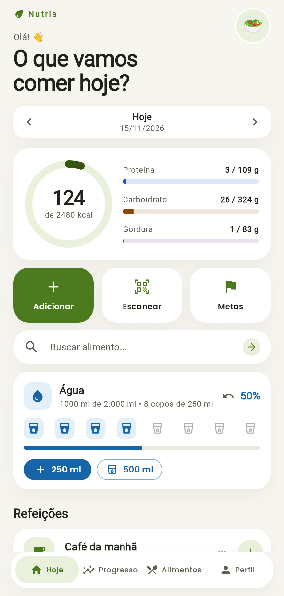
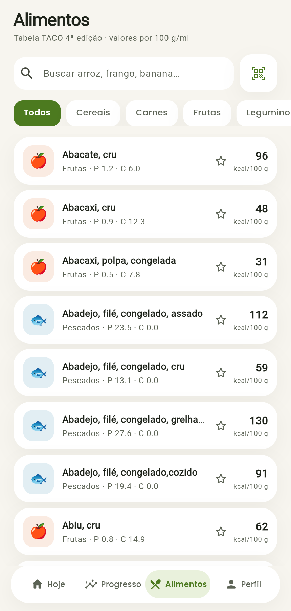
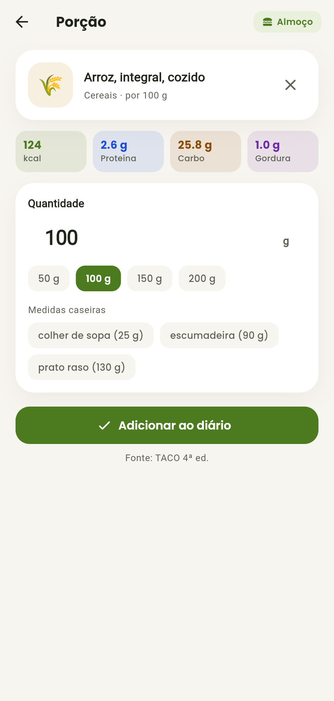
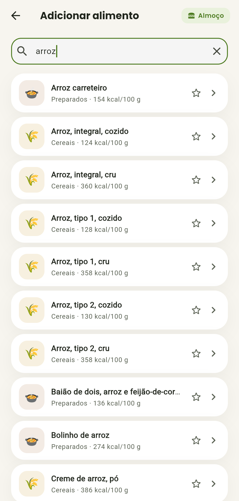
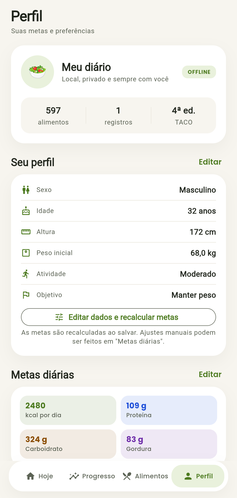
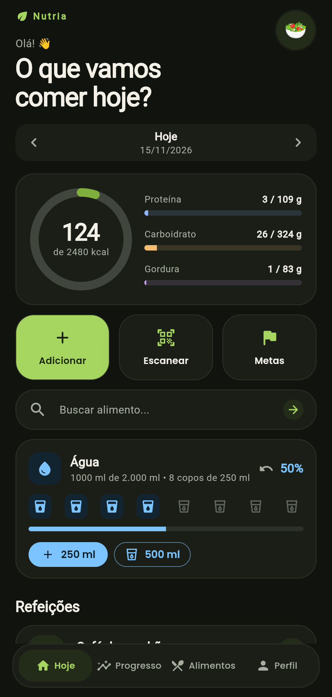
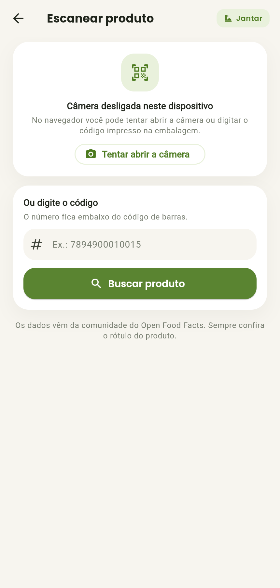
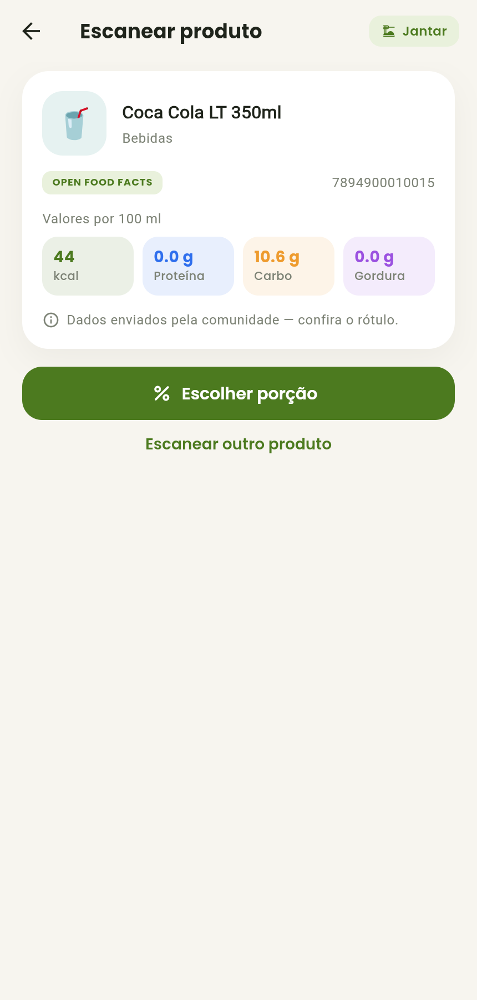

# Nutria

Diário alimentar **local-first** para Android e iOS. Registra o que você comeu
(100 g de arroz + 100 g de frango) e mostra calorias, proteína, carboidrato e
gordura do dia — sem perder dados quando o app trava ou a internet cai.

> Projeto em `/home/joao/programas/nutria`.

| Hoje | Alimentos | Porção |
|---|---|---|
|  |  |  |

| Busca | Perfil |
|---|---|
|  |  |

| Hoje no tema escuro |
|---|
|  |

Claro, escuro ou o que o sistema pedir — a escolha fica salva no aparelho
(**Perfil → Aparência**). A água do dia (copos de 250 ml, +250/+500 ml e
desfazer) fica no próprio diário, logo abaixo da busca.

---

## Por que ele não perde dados

O problema clássico (app trava, volta para a home e o formulário some) é
resolvido na arquitetura, não com "mais features":

1. **SQLite local é a fonte da verdade.** Toda escrita vai primeiro para o
   banco no aparelho (`Drift`). A UI lê de *streams* reativos.
2. **Rascunho persistido.** O fluxo de adicionar alimento salva um draft a cada
   alteração (`Drafts`), com debounce de ~200 ms. Matar o app no meio não perde
   o que foi digitado.
3. **Snapshot no diário.** Cada registro guarda os macros do momento do log.
   Corrigir o catálogo depois **não** reescreve o histórico.
4. **Sync idempotente.** Cada registro tem um `syncId` (UUID) para que o envio
   à nuvem possa ser repetido sem duplicar.

### Como isso é testado

`flutter test` cobre, entre outros:

- importação dos **597 alimentos da TACO**;
- busca sem acento/maiúsculas (`feijao` encontra "Feijão");
- snapshot imutável quando o catálogo muda;
- recálculo proporcional ao editar gramas;
- **rascunho sobrevivendo a fechar e reabrir o banco** (simula matar o app);
- leitura dos valores do **Open Food Facts**, fallback de kJ para kcal e
  mensagens de erro (produto inexistente / sem rede);
- **cache local** do produto escaneado (não duplica e aparece na busca).

---

## Stack

| Camada | Tecnologia |
|---|---|
| App | Flutter (Android + iOS) |
| Banco local | Drift (SQLite) |
| Estado | Riverpod 3 |
| Dados de alimentos | TACO 4ª ed. (NEPA/UNICAMP), via `brolesi/taco` |
| Produtos industrializados | Open Food Facts (API pública) + cache local |
| Código de barras | `mobile_scanner` (CameraX/AVFoundation/ZXing) |
| UI | Material 3 |

---

## Rodando

```bash
cd /home/joao/programas/nutria
flutter pub get
dart run build_runner build --delete-conflicting-outputs   # gera database.g.dart
flutter run          # com um device/emulador conectado
flutter test         # suíte de persistência + widget
```

> Se você alterar `lib/data/db/database.dart`, rode o `build_runner` de novo.

---

## Código de barras + Open Food Facts

No cartão **Escanear** da aba Hoje (ou no ícone de scanner da aba Alimentos):

1. A câmera lê EAN-8/13, UPC-A/E, Code 128/39 ou ITF-14.
2. O app procura o código no **cache local** (`foods.barcode`). Se já escaneou
   antes, funciona até sem internet.
3. Se não tem, consulta a API pública do **Open Food Facts** e grava o produto
   com `source = 'off'`, uma porção declarada (ex.: lata de 350 ml) e a
   categoria já traduzida para o vocabulário do app.
4. A tela de resultado mostra os valores por 100 g/ml e um aviso: os dados são
   da comunidade, então **confira o rótulo**. Depois é só escolher a porção.

No navegador (e em qualquer aparelho sem câmera) o código pode ser digitado
manualmente — o caminho de busca é o mesmo.

Exemplo real: Coca-Cola lata 350 ml (`7894900010015`) → 44 kcal/100 ml,
350 ml = **154 kcal**.

| Escanear | Produto encontrado |
|---|---|
|  |  |

---

## Versão web (para testar no navegador)

O app também roda no navegador, com SQLite compilado para WebAssembly. No web a
persistência fica no próprio navegador (OPFS), por origem.

```bash
flutter build web --release --no-web-resources-cdn
python3 tool/serve_web.py 8080
# abra http://localhost:8080
```

O `tool/serve_web.py` envia os headers de isolamento de origem (COOP/COEP)
necessários para o OPFS/SharedArrayBuffer e o MIME correto de `.wasm`.

Os arquivos `web/sqlite3.wasm` e `web/drift_worker.js` vêm do pacote `drift`.
Se atualizar o Drift, recopie os dois.

> A web é ótima para demonstração e testes rápidos. O alvo do produto continua
> sendo Android/iOS.

---

## Estrutura

```
lib/
  main.dart
  app/
    app.dart              # MaterialApp + estado de seed
    providers.dart        # providers globais (db, repositórios, dia, metas)
  core/
    text.dart             # normalização de busca, datas, formatação
    theme.dart            # paletas clara/escura (ThemeExtension), tipografia Poppins
    meals.dart            # refeições (café, almoço, jantar, lanches)
    food_style.dart       # emoji/cor por categoria da TACO
  data/
    db/
      database.dart       # tabelas Drift
      database.g.dart     # gerado
      seed.dart           # importa TACO + medidas caseiras
    repositories/
      food_repository.dart
      diary_repository.dart
      draft_repository.dart
      goals_repository.dart
    remote/
      open_food_facts.dart # consulta + normalização de produtos escaneados
  features/
    shell/                # navegação por abas (Hoje, Progresso, Alimentos, Perfil)
    diary/                # aba Hoje (dia, macros, água, refeições)
    foods/                # aba Alimentos (busca, filtros, catálogo)
    profile/              # aba Perfil (perfil, metas, tema, avisos, backup)
    add_food/             # busca, porção, alimento personalizado, draft
    barcode/              # leitor de código de barras + resultado do produto
    goals/                # edição de metas
  shared/widgets/         # cards, anel de calorias, macros, avatar, nav
assets/
  fonts/                  # Poppins (Regular → ExtraBold)
  data/
    taco_foods.csv        # 597 alimentos (valores por 100 g)
    servings.csv          # medidas caseiras curadas (colher, concha, fatia…)
test/
  persistence_test.dart
  open_food_facts_test.dart # parsing, erros e categorias do OFF
  off_repository_test.dart  # cache local do produto escaneado
  widget_test.dart
```

---

## Modelo de dados

- `foods` — catálogo (nome, `searchKey` normalizado, macros por 100 g, fonte,
  `barcode` para produtos industrializados).
- `food_servings` — medidas caseiras (`"colher de sopa" = 25 g`).
- `diary_entries` — registro com **snapshot** de macros + `syncId`.
- `drafts` — rascunho de formulário (chave = tela + dia + refeição).
- `goals` — metas diárias (linha única).

---

## Próximos passos

### 1. Sync com a nuvem (multi-dispositivo / backup)

- Supabase (Postgres + Auth) + **PowerSync** (SDK Flutter) ou fila própria.
- A fila envia `diary_entries` pendentes com `syncId`; conflito resolvido por
  `updatedAt` (last-write-wins) ou merge por campo.
- Nada disso bloqueia a UI: a escrita local acontece antes.

### 2. IA (a camada de interpretação, não de verdade)

Regra: **a IA não inventa caloria**. Ela interpreta e roteia:

```
"comi 2 ovos e um pão francês"
        │
        ▼
LLM com tool calling ──► search_food_db("ovo")
        │                 search_food_db("pão francês")
        ▼
achou na TACO? usa o valor oficial
não achou? Open Food Facts
não achou? IA + busca web, com flag "estimado" e confiança
```

- Modelos baratos (`gpt-5-mini`, `gemini-flash`) para texto; vision para foto
  de rótulo.
- Sempre **structured output** (JSON schema) e cache do resultado em
  `ai_lookup_cache` — a mesma pergunta nunca custa duas vezes.
- A chave da API fica em uma Edge Function do Supabase, nunca no app.

### 3. Publicação

- **LGPD:** dado de saúde é sensível (art. 11) — consentimento explícito,
  criptografia e política de privacidade.
- **Regulatório (CFN):** prescrição dietética é ato privativo de nutricionista.
  Este app é posicionado como **diário/contador** — não como prescritor de
  dieta. Para publicar, avalie um responsável técnico.
- iOS exige Mac para build/assinatura.

---

## Licença dos dados

Os valores nutricionais pertencem à TACO (NEPA/UNICAMP) e são redistribuídos
por serem de acesso público. Consulte as fontes primárias para os termos de uso.
